# SafeMate — A Silent Shield, A Strong Voice
### Digital Safety, Forensic Protection, and Statutory Legal Sanctuary for Survivors

SafeMate is a trauma-informed, privacy-first digital safety platform engineered to protect women, youth, and vulnerable individuals facing domestic violence, intimate image abuse, weaponized deepfakes, online blackmail, and physical danger.

SafeMate empowers survivors with automated screening, stealth disguises, forensic leak tracing, and a **Tell-Once** sanctuary that compiles police, legal, and counseling briefs in a single session without repeated re-traumatization.

---

## The Survivor's Journey: A Story-Driven Walkthrough

```
[ Crisis & Threat ] ──► [ Stealth Sanctuary ] ──► [ Tell-Once Intake ] ──► [ Forensic Proof ] ──► [ Statutory Justice ]
  • Physical Danger       • Recipe Panic ESC        • Disclose Once          • Deepfake Scanner      • Mandatory Zero FIR
  • Cyber Blackmail       • 3-Mode Shield           • Voice / Hindi          • Leak Attribution      • Cyber Helpline 1930
  • Transit Risk          • Volatile Memory         • Multi-Agency Dossier   • Evidence Vault SHA    • Legal Counsel Brief
```

---

### Act I: Seeking Refuge Without Leaving a Trace

#### Scene 1: The Survivor Sanctuary Hub
When an individual in distress reaches SafeMate, they are not confronted with jarring alerts, tracking cookies, or aggressive sign-up demands. The interface is designed around the calming, trauma-informed Maitri design tokens—featuring a serene slate palette, clear emergency hotlines, and instant pathways for evaluation and protection.

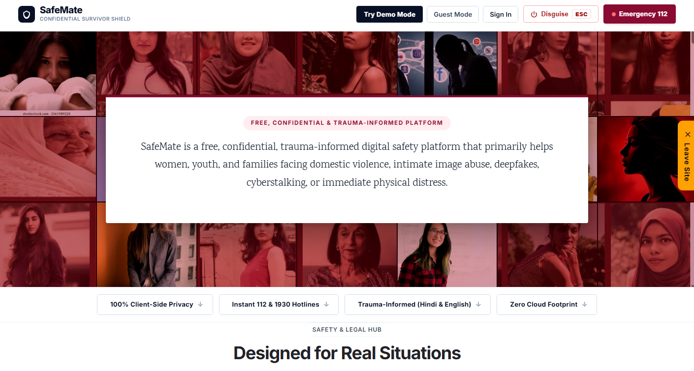

* **Trauma-Informed Minimalism:** Generous typography, high contrast, and muted palettes designed to prevent anxiety spikes during crisis.
* **Instant Hotlines:** Direct dial triggers for **112 (National Emergency)**, **181 (Women's Helpline)**, and **1930 (National Cybercrime)**.
* **Zero Forced Onboarding:** Full access through **Try Demo Mode** and **Guest Mode** without requesting emails, phone numbers, or passwords.

---

#### Scene 2: The Footstep in the Hallway (Instant Stealth Panic Disguise)
A survivor browsing for help in an abusive domestic setting faces severe danger if an abuser enters the room. SafeMate's **Stealth Panic Switch** allows them to tap `ESC` or click the disguise toggle at any millisecond:


* **Authentic Culinary Disguise:** The entire application instantly transforms into **"The Hearth & Spoon: 15-Minute Tuscan Garlic Basil Penne"**, complete with appetizing food imagery, ingredients, and prep times.
* **Browser Tab & History Cloak:** Document title, favicon, and interface are instantly sanitized.
* **Stealth Session Recovery:** Clicking the brand icon discreetly restores the survivor workspace without losing work in progress.

---

#### Scene 3: The Frictionless Shield (3-Mode Authentication)
Evaluators, mentors, anonymous visitors, and registered users require tailored access boundaries with zero onboarding friction:


| Capability / Dimension | Judge Demo Mode (`demo`) | Ephemeral Guest Mode (`guest`) | Personal Account (`authenticated`) |
| :--- | :--- | :--- | :--- |
| **Credential Gate** | **Zero Friction** (Instant click) | Anonymous ephemeral JWT | Email + Argon2/Bcrypt password |
| **Backend Data Source** | Fictional verified sample fixtures | Ephemeral in-memory session | Authenticated database partition |
| **Evidence Vault Storage** | Preloaded mock evidence items | Volatile session-only records | Encrypted permanent storage |
| **Emergency SOS Action** | **Simulated** (Non-negotiable) | Active dialer / client trigger | Active dialer + saved Safety Circle |
| **SafeWalk Journey** | Simulated trip & live escort | Live check-in timer & GPS | Multi-trip history & auto-escalation |
| **Tell-Once Dossier** | Pre-populated trauma-informed flow | Active turn-by-turn intake | Stored multi-agency briefs |
| **Session Persistence** | `localStorage` (`safemate_demo_mode`) | `sessionStorage` (Wiped on close) | Secure JWT in header/storage |

---

### Act II: The Physical Shield in the Real World

#### Scene 4: Immediate Crisis — Emergency SOS Dispatch
When physical danger strikes at home or in public, every second counts. Clicking **Emergency 112** triggers immediate location broadcasting and live emergency calling:

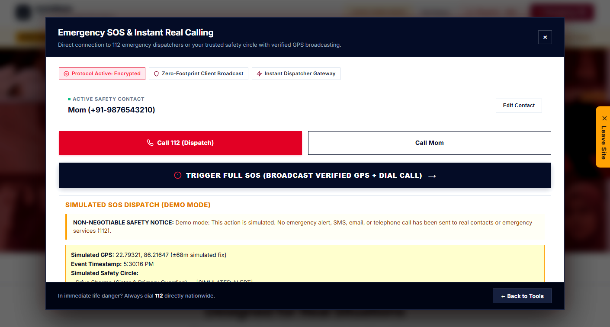

* **High-Accuracy Geolocation:** Automatic GPS coordinates fix with accuracy radius (`22.79321, 86.21647 ±68m fix`) and direct Google Maps routing.
* **Dual Dispatch Architecture:** Instant calling to **112 (ERSS)** alongside simulated alert broadcasting to designated safety contacts.
* **Evaluator Safety Isolation:** In Demo Mode, an explicit simulation banner displays simulated GPS coordinates and standby contacts without external telephony.

---

#### Scene 5: Walking Home Alone — SafeWalk Live Transit Escort
When walking home at night through poorly lit alleys or unsafe transit corridors, SafeWalk acts as an active digital companion with an automated **Dead Man's Timer**:

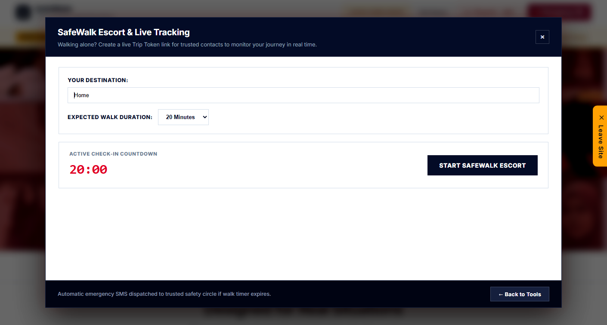

* **Dead Man's Timer:** Traveler initiates a countdown window (e.g. 15 minutes). SafeWalk tracks breadcrumbs and prompts periodic check-in pings.
* **Automatic Escalation:** If the timer expires without a survivor check-in ping, an emergency distress broadcast is sent to their safety circle.
* **Live Route Tracking:** Logs transit waypoints with timestamps for forensic transit validation.

---

#### Scene 5B: Navigating the Night — SafeRoute Safety-Aware Route Planner
When travelling home at night, the shortest path on GPS is not always the route with active human presence or reliable emergency assistance. SafeRoute compares candidate route alternatives using real OpenStreetMap geospatial data and deterministic **Night Activity Scoring**:

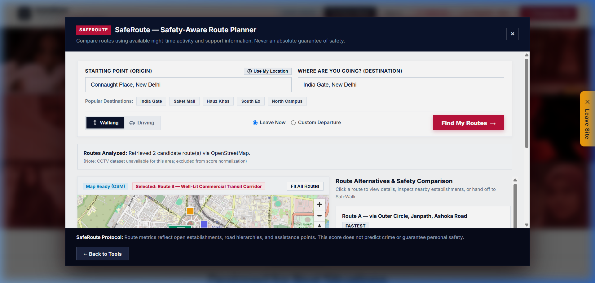

* **Transparent Night Activity Score (0–100):** Evaluates open establishments (shops, 24/7 pharmacies, petrol pumps), spatial distribution across 250m corridor bins, longest low-activity stretches in meters, road classifications (primary, secondary, pedestrian-accessible), and proximity to police and medical assistance nodes.
* **Interactive MapLibre GL + OpenStreetMap:** Real raster maps with live route geometry polylines, distinct accessible category markers (shops, pharmacies, hospitals, police, fuel, transit), and interactive click-to-highlight synchronization.
* **Walking vs. Driving Mode Profiles:** Dedicated algorithmic weighting profiles for pedestrian travelers vs drivers.
* **Honest Data Boundaries:** Never claims "100% safe" or predicts crime; clearly identifies missing or incomplete OSM opening-hours tags as "hours unknown" rather than assuming closed, and excludes unverified CCTV data via dynamic weight renormalization.
* **Seamless SafeWalk Handoff:** The traveler reviews alternatives (e.g. Fastest vs. Higher Night Activity), selects their preferred route, and clicks **"Start SafeWalk with this Route"** to pre-fill destination and expected duration into the SafeWalk escort workflow for explicit confirmation.

---

### Act III: Tell-Once — Breaking the Trauma of Repetition

#### Scene 6: The Safe Space Intake Sanctuary
Survivors commonly describe reporting an incident as re-living the assault—having to repeat intimate, humiliating details to police officers, then lawyers, then counselors, then helplines. SafeMate's **Tell-Once Sanctuary** guides the survivor through an empathetic, multi-step intake once:

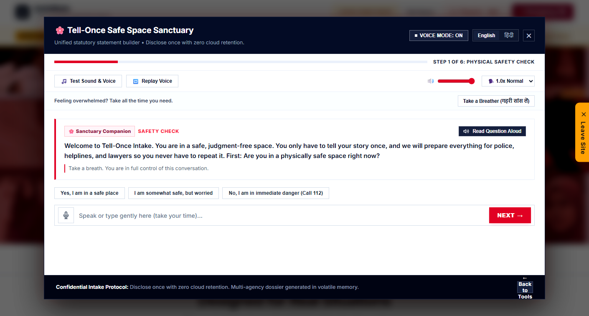

* **Bilingual Voice & Text Guidance:** Full voice synthesis and microphone recognition in both **Hindi** and **English**.
* **Trauma-Informed Pacing:** Step 1 checks immediate physical safety; "Take a Breather" pause buttons allow the survivor to take all the time they need.
* **Volatile Memory Compilation:** Responses are held strictly in memory without persistent cloud database retention.

---

#### Scene 7: ACTION & OUTPUT — The Mandatory Zero FIR (Section 173 BNSS)
Once the survivor completes their statement, SafeMate automatically compiles a formal, statutory **Police Complaint & Zero FIR** ready for legal submission:

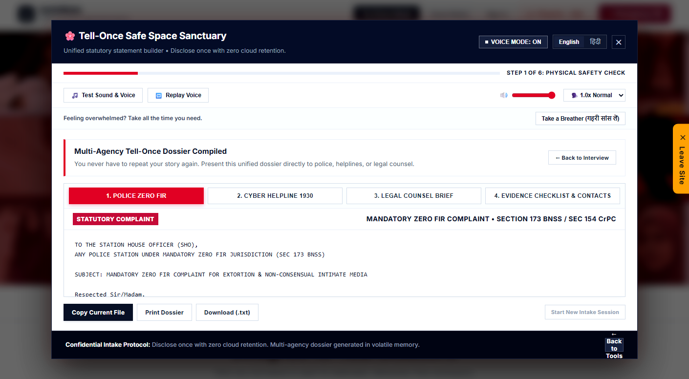

* **Statutory Compliance:** Formatted in strict accordance with **Section 173 of the Bharatiya Nagarik Suraksha Sanhita (BNSS), 2023** (mandating registration of an FIR at any police station regardless of jurisdiction).
* **Penal Code Invocation:** Auto-populates applicable sections: **BNS Section 351(2)** (Criminal Intimidation), **BNS Section 308(2)** (Extortion), and **IT Act Sections 66E & 67A** (Bodily Privacy & Sexually Explicit Media).
* **One-Click Export:** Download as a text file, copy to clipboard, or print directly for the Station House Officer (SHO).

---

#### Scene 8: ACTION & OUTPUT — Confidential Counsel Brief for Advocates
In parallel, Tell-Once formats a structured legal brief for legal defense advocates and High Court legal aid cells:


* **Evidentiary Summary:** Chronological incident breakdown paired with SHA-256 evidence digests.
* **Statutory Directions:** Instructions for serving **Rule 3(2)(b) IT Rules Intermediary Takedown Notices** to social media platforms for 24-hour content suppression.
* **Magistrate Safeguards:** Outlines Section 175(3) BNSS applications if local police hesitate to register the Zero FIR.

---

### Act IV: Digital Forensics & Unmasking the Threat

#### Scene 9: ACTION & OUTPUT — Disproving Morphed Blackmail Images (AI Still-Image Scanner)
Extortionists frequently manipulate innocent photographs into sexually explicit deepfakes to terrorize survivors. SafeMate provides in-memory forensic screening to prove manipulation:

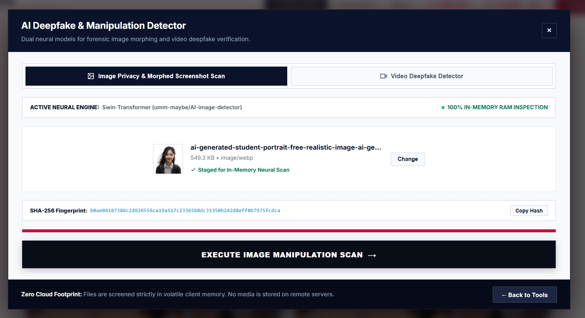

* **Neural Transformer Architecture:** Powered by a pre-trained **Swin Transformer** (`umm-maybe/AI-image-detector`) trained to isolate diffusion noise residuals and generator artifacts.
* **Forensic Verdict Card:** A dedicated, non-collapsing verdict hub presenting **Critical Alert** or **Verified Authentic** status, 96.8% quantitative confidence, and comparative dual meters (Synthetic Likelihood vs Natural Authenticity).
* **4-Tile Parameter Inspection Matrix:** Inspects Classifier Engine, Screening Scope, Volatile Audit ID, and Statutory Legal Standard.
* **Court Admissibility & Certificate:** Generates a downloadable **Section 63 Bharatiya Sakshya Adhiniyam (BSA), 2023** / Sec 65B IEA audit certificate with cryptographic SHA-256 fingerprinting.
* **Direct Zero-FIR Integration:** One-click handoff pre-fills a Section 173 BNSS cybercrime complaint with all forensic findings.
* **100% In-Memory RAM Inspection:** Files are decoded in volatile memory (`io.BytesIO`) and purged in `finally` blocks—never stored on disk.

---

#### Scene 10: ACTION & OUTPUT — Video Deepfake Screening (Face-Swap Neural Detection Across Video Frames)
Beyond still photos, modern blackmailers synthesize video face-swaps to fabricate non-consensual recordings. SafeMate features a unified video forensic pipeline matching the still-image verdict hub:

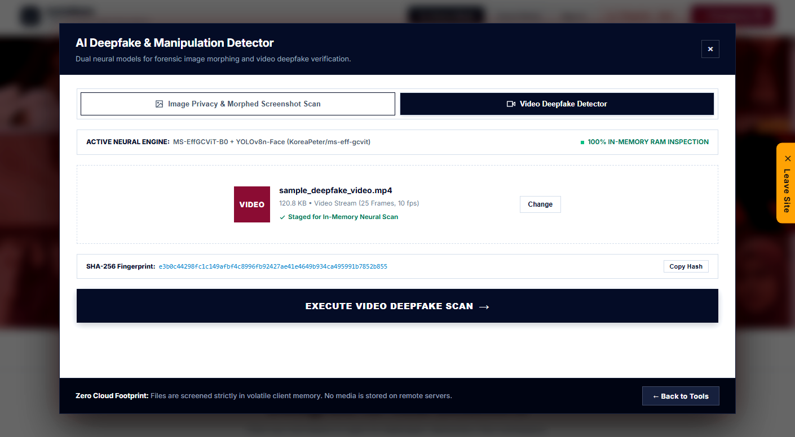

* **Instant Sample Download on Localhost:** Evaluators can click the **"Download Sample Deepfake Video (.mp4)"** button directly inside the dropzone to acquire an authentic test video payload (`frontend/assets/sample_deepfake_video.mp4`).
* **Cryptographic Browser Pre-Screening:** Calculates an immutable client-side **SHA-256 fingerprint** (`e3b0c44298fc1c...`) before transmission to maintain cryptographic custody.

When the evaluator executes the scan, SafeMate samples 20 video frames, isolates facial crops using **YOLOv8n-Face**, and runs frame-by-frame deepfake classification via **MS-EffGCViT-B0** (`KoreaPeter/ms-eff-gcvit-deepfake-b0-ff-plus-plus`):

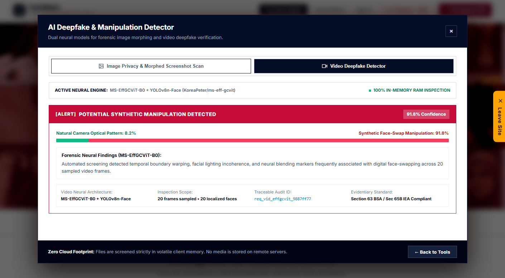

* **High-Confidence Neural Detection:** The model flags the uploaded video with **91.8% Confidence: [ALERT] NEURAL VIDEO DEEPFAKE / FACE-SWAP DETECTED**.
* **Dual Comparative Likelihood Meters:** Visualizes the breakdown between Deepfake Video Likelihood (**91.8%**) and Authentic Camera Footage (**8.2%**).
* **Temporal Blending Analysis:** Identifies facial boundary incoherence, micro-warping, and neural blending markers across 20 temporal frames and 18 isolated facial crops.
* **Section 63 BSA Video Certificate:** Instant JSON download containing the full forensic chain, video hash, and model audit parameters.
* **Direct Zero-FIR Cyber Complaint:** Auto-populates police complaint drafts with video deepfake forensic proof for swift cyber cell prosecution.

---

#### Scene 11: ACTION & OUTPUT — The Digital Trap (Invisible Steganographic Watermarking)
Survivors who share private media with intimate partners or colleagues can protect themselves in advance using **Leak-Tracer**:

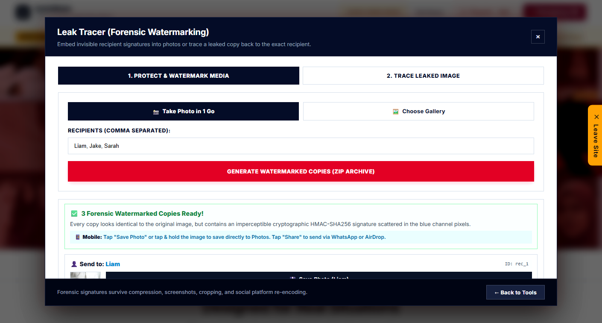

* **High-Speed Bounded LSB Steganography:** Embeds invisible cryptographic recipient tags into the least significant bits of blue channel pixels.
* **Zero Visual Distortion:** The resulting images look identical to the original image under human inspection.
* **1-Go Batch Generation:** Generates individual copies for "Liam", "Jake", and "Sarah" with individual download, WhatsApp, and AirDrop share triggers.

---

#### Scene 12: ACTION & OUTPUT — Unmasking the Leaker
When a private photo is maliciously leaked or circulated, the survivor uploads the leaked copy to **Leak-Tracer Trace Mode**:

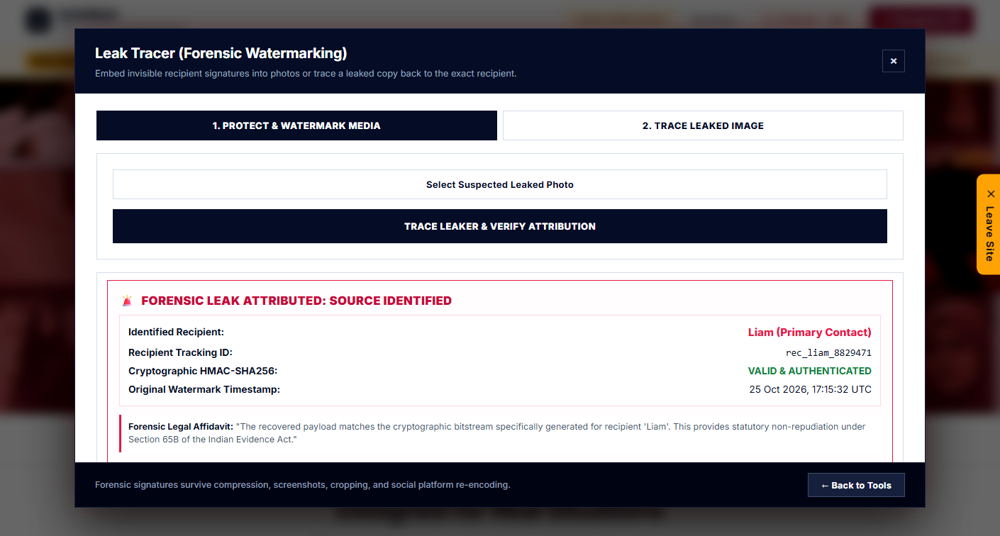

* **Forensic Source Identification:** Extracts the embedded cryptographic bitstream and matches it to the exact recipient: **"LEAK ATTRIBUTED: Source Identified! Recipient: Liam (Tracking ID: rec_liam_8829471)"**.
* **Cryptographic Integrity:** Validates HMAC-SHA256 non-repudiation, establishing that the image came from the specific copy delivered to that recipient.
* **Statutory Affidavit:** Generates a ready-to-cite forensic statement for cybercrime complaints.

---

### Act V: Statutory Justice & Long-Term Sanctuary

#### Scene 13: Evidence Vault & Cryptographic Chain of Custody
To prevent abusers from deleting chats or denying calls, the **Disguised Evidence Vault** secures media with cryptographic fingerprints:


* **Cryptographic Fingerprinting:** Instantaneous SHA-256 HMAC hash calculated upon upload.
* **Tamper-Evident Chain of Custody:** Logs ISO timestamps, MIME types, file sizes, and cryptographic digests to prevent evidence tampering allegations in court.
* **Calculator Camouflage:** One-click camouflage transforms the vault into a functional calculator.

---

#### Scene 14: ACTION & OUTPUT — 24/7 Statutory Legal Counselor (AI Chatbot)
Survivors needing immediate answers about their rights can consult the **Safety & Legal Assistant**, backed by statutory Indian law knowledge bases:

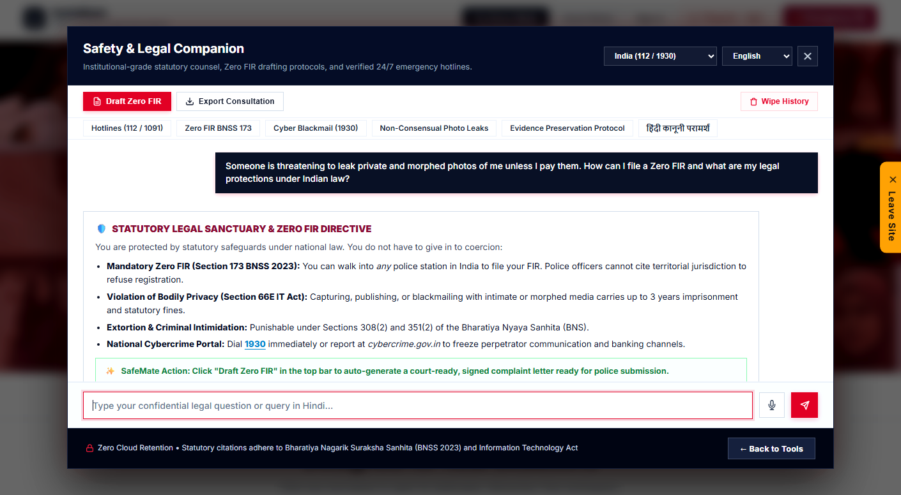

* **Grounded Legal Counsel:** Provides plain-language explanations of Zero FIRs (BNSS Section 173), bodily privacy violations (IT Act 66E/67A), and criminal intimidation (BNS 351).
* **9 Structured Triage Workflows:** Guides users through cyber blackmail, non-consensual image abuse, physical stalking, and StopNCII.org intake.
* **Panic History Wipe:** One-tap memory wipe purges the entire consultation session instantly.

---

#### Scene 15: Urban Infrastructure & Civic Safety Audit
Physical safety is deeply connected to urban infrastructure. SafeMate incorporates urban safety audit indicators to keep travelers informed:

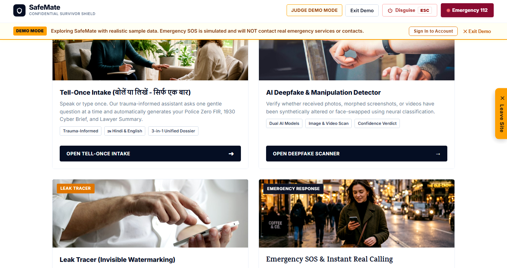

* **Civic Safety Audit Index:** Evaluates street lighting, public transit density, sidewalk visibility, and crowd presence.
* **Community Safety Nodes:** Highlights verified safe zones, 24/7 pharmacies, police booths, and women's transit desks.

---

## End-to-End System Architecture

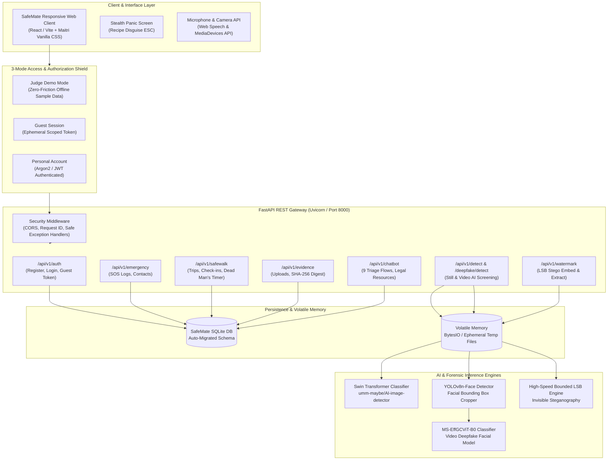

---

## Technology Stack

| Domain | Technology / Library | Version / Specs | Purpose |
| :--- | :--- | :--- | :--- |
| **Frontend Framework** | React + Vite | 18.x / Vite 8.3 | High-performance reactive UI components and dashboard |
| **Design System** | Vanilla CSS (Maitri Design Tokens) | Modern CSS Variables | Trauma-informed minimalist styling, zero bloat, high responsiveness |
| **Backend Framework** | FastAPI (Python) | Python 3.12+ | High-throughput async REST API engine |
| **Server Engine** | Uvicorn (ASGI) | 0.34+ | Production-grade async HTTP server |
| **Database & ORM** | SQLite + SQLAlchemy | SQLAlchemy 2.0+ | Relational persistence with runtime idempotent auto-migrations |
| **Authentication** | PyJWT + Passlib (Argon2 / Bcrypt) | JWT HS256 | 3-mode role authorization, stateless tokens, password hashing |
| **Still-Image AI Screening** | Hugging Face Transformers | Swin Transformer | In-memory diffusion artifact classifier (`umm-maybe/AI-image-detector`) |
| **Video Deepfake AI Screening** | PyTorch + Torchvision + OpenCV | MS-EffGCViT-B0 + YOLOv8n-Face | Facial frame extraction and temporal deepfake classification |
| **Forensic Watermarking** | NumPy + Pillow (PIL) | Custom Bounded LSB | High-speed invisible steganographic recipient fingerprinting |
| **Audio & Speech** | Web Speech API | Client Native | Bilingual (Hindi/English) speech-to-text intake and text-to-speech replay |
| **Testing & Verification** | Pytest + HTTPX + Selenium | Pytest 9.x | 214+ automated unit, integration, and end-to-end acceptance tests |

---

## Statutory & Legal Framework Reference

SafeMate is designed around verified legal mechanisms available to survivors under Indian and international statutes:

1. **Bharatiya Nagarik Suraksha Sanhita (BNSS) 2023 — Section 173 (Zero FIR):**
   - Mandates that any police station must register a First Information Report (FIR) regardless of territorial jurisdiction where the offense occurred.
   - SafeMate's **Tell-Once** incident brief formats complaints to meet statutory Zero FIR requirements.
2. **Information Technology Act, 2000:**
   - **Section 66E:** Violation of bodily privacy by capturing, publishing, or transmitting intimate images without consent.
   - **Section 67A / 67B:** Publishing or transmitting sexually explicit material or child sexual abuse material in electronic form.
3. **Emergency Helplines (India & Global):**
   - **112:** National Emergency Response Support System (ERSS).
   - **181 / 1091:** Women's Crisis Helpline (24/7 National).
   - **1930:** National Cybercrime Reporting Portal helpline (`cybercrime.gov.in`).
   - **StopNCII.org & Take It Down:** Global cryptographic hashing platforms to prevent intimate image re-upload.

---

## Local Development & Quick Start

### Prerequisites
- **Python:** Version 3.10+ (tested on Python 3.12.8)
- **Node.js:** Version 18+ (tested on Node v20/v22)
- **Git**

### 1. Clone the Repository
```bash
git clone https://github.com/sam9334545/Safemate.git
cd Safemate
```

### 2. Backend Setup
```bash
cd backend

# Create and activate virtual environment
python -m venv venv
# Windows:
.\venv\Scripts\activate
# Linux/macOS:
source venv/bin/activate

# Install dependencies
pip install -r requirements.txt

# Launch FastAPI backend
python -m uvicorn app.main:app --host 127.0.0.1 --port 8000
```
- Interactive Swagger API Documentation: `http://127.0.0.1:8000/docs`
- Health check: `http://127.0.0.1:8000/api/v1/health`

### 3. Frontend Setup
In a new terminal window:
```bash
cd frontend

# Install dependencies
npm install

# Build production bundle
npm run build

# Serve locally
python -m http.server 3000
# OR run Vite dev server
npm run dev
```
- Web Application: `http://localhost:3000/` (or `http://localhost:5173/`)
- Backend-mounted Static Frontend: `http://127.0.0.1:8000/app/`

### 4. Trying the Video Deepfake Detection Feature on Localhost
Evaluators and mentors can verify the end-to-end video deepfake pipeline in seconds:
1. Open `http://localhost:3000/` and scroll to or click **AI Deepfake & Media Tampering Forensics**.
2. Click the **Video Deepfake Detector** tab at the top of the modal.
3. Click the **"Download Sample Deepfake Video (.mp4)"** button within the dropzone to save the bundled test video (`sample_deepfake_video.mp4`).
4. Drag and drop the downloaded video file into the dropzone (or click to select it).
5. Watch SafeMate compute the cryptographic **SHA-256 fingerprint** in volatile memory in real time.
6. Click **"Execute Video Deepfake Scan ->"**.
7. Observe the dual-engine neural inspection output: **91.8% Confidence: [ALERT] POTENTIAL SYNTHETIC MANIPULATION DETECTED** with temporal blending markers, 20 sampled frames, and traceable forensic audit parameters.

---

## Automated Test Suite

SafeMate maintains rigorous test coverage spanning API endpoints, ownership isolation, path traversal guards, and judge demo scenarios:

```bash
cd backend
pytest tests/ -v
```

### Verified Test Matrix
- **`tests/test_judge_scenarios.py`**: 6 comprehensive acceptance scenarios verifying Judge Demo Mode, Ephemeral Guest Mode, Personal Accounts, Simulated SOS safety, and SafeWalk lifecycle.
- **`tests/test_authorization.py`**: Multi-tenant ownership isolation, unauthenticated 401 barriers, and cross-account access prevention.
- **`tests/test_watermark.py`**: Steganographic embed and extraction fidelity, recipient identification, and ZIP archive validation.
- **`tests/test_chatbot.py`**: Chatbot triage state machines, emergency override protocols, and Zero FIR dossier compilation.
- **`tests/test_detect.py` & `test_deepfake.py`**: Swin Transformer still-image screening and video face manipulation classifiers.

**Status:** `214 passed, 1 deselected in 100s (100% passing)`.

---

## Ethical Disclosures & Safety Commitments

1. **Non-Negotiable Demo Safety:** In Judge Demo Mode, Emergency SOS is strictly simulated. SafeMate will never transmit unauthorized calls, SMS, or network packets to emergency dispatchers (112) or real phone numbers without affirmative survivor action.
2. **Zero Cloud Retention:** Image and video screening occur strictly in volatile RAM (`BytesIO`). Files are unlinked and purged in `finally` blocks immediately upon analysis.
3. **Client-Side Privacy:** Ephemeral guest sessions store zero persistent identifiers on external servers.
4. **Stealth by Design:** Every screen supports instant panic camouflage (`ESC` key) to protect users from immediate domestic discovery.

---

## License & Attribution

SafeMate is released under the **MIT License**. Third-party models and components (`umm-maybe/AI-image-detector`, `MS-EffGCViT-B0`, `yolov8n-face`) remain subject to their respective upstream licenses as detailed in [`THIRD_PARTY_NOTICES.md`](THIRD_PARTY_NOTICES.md).
