# SafeMate — A Silent Shield, A Strong Voice
### Digital Safety, Forensic Protection, and Statutory Legal Sanctuary for Survivors

SafeMate is a trauma-informed, privacy-first digital safety platform engineered to protect women, youth, and vulnerable individuals facing domestic violence, intimate image abuse, weaponized deepfakes, online blackmail, and physical danger.

SafeMate empowers survivors with automated screening, stealth disguises, forensic leak tracing, and a **Tell-Once** sanctuary that compiles police, legal, and counseling briefs in a single session without repeated re-traumatization.

---

## Visual Walkthrough & System Capabilities

### 1. Homepage & Trauma-Informed Survivor Hub
The landing interface greets users with an authentic, calming aesthetic, quick-action emergency tiles, a stealth panic switch, and three flexible access pathways (**Try Demo Mode**, **Guest Mode**, **Sign In**).


---

### 2. The 3-Mode Shield: Authentication & Authorization Matrix
SafeMate accommodates evaluators, anonymous visitors, and personal users with strict authorization boundaries and zero setup barriers:

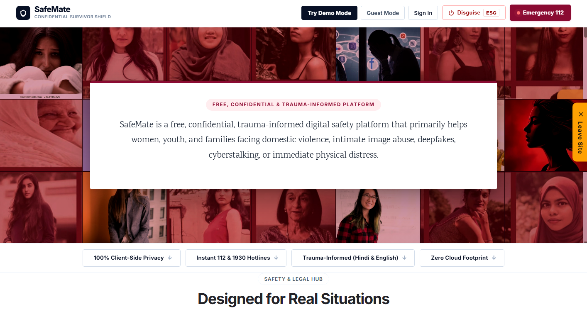

| Capability / Resource | Judge Demo Mode (`demo`) | Ephemeral Guest Mode (`guest`) | Personal Account (`authenticated`) |
| :--- | :--- | :--- | :--- |
| **Authentication Requirement** | Zero credentials / Instant click | Anonymous ephemeral JWT | Email + Argon2/Bcrypt password |
| **Backend Data Source** | Fictional verified sample fixtures | Ephemeral in-memory session | Authenticated database partition |
| **Evidence Vault Storage** | Preloaded mock evidence items | Volatile session-only records | Encrypted permanent storage |
| **Emergency SOS Action** | **Simulated** (Non-negotiable) | Active dialer / client trigger | Active dialer + saved Safety Circle |
| **SafeWalk Journey** | Simulated trip & live escort | Live check-in timer & GPS | Multi-trip history & auto-escalation |
| **Tell-Once Dossier** | Pre-populated trauma-informed flow | Active turn-by-turn intake | Stored multi-agency briefs |
| **Session Persistence** | `localStorage` (`safemate_demo_mode`) | `sessionStorage` (Wiped on close) | Secure JWT in header/storage |

---

### 3. Zero-Friction Judge Demo Experience
Judges, evaluators, and mentors can explore every single module offline with realistic sample data without encountering login gates, registration forms, or network failures.

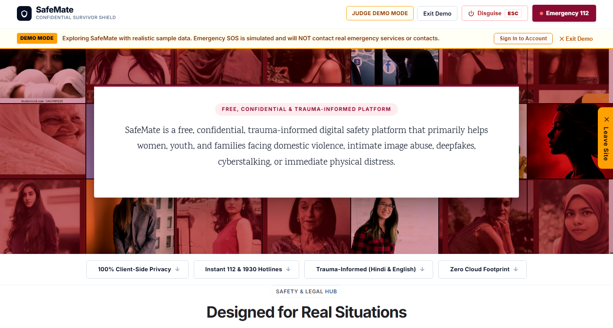

> **Safety Notice:** In Judge Demo Mode, Emergency SOS triggers a **simulated dispatch**. No phone calls, SMS messages, or emergency transmissions are ever dispatched to real authorities (112) or contacts.

---

### 4. Emergency SOS & Simulated Safety Dispatch
One-tap access to national emergency services (112), primary guardians, and instant GPS coordinate broadcasts with high-visibility dispatch logging.

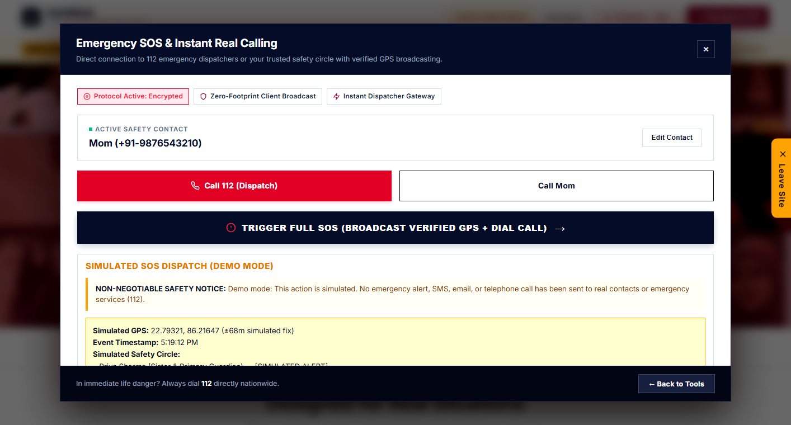

- **One-Tap Emergency Calling:** Direct protocol integration for national emergency dispatch (`tel:112`) and trusted safety circle contacts.
- **High-Accuracy Geolocation:** Automatic GPS coordinates fix with accuracy radius and Google Maps live location routing.
- **Evaluator Safety Isolation:** In Demo Mode, an explicit simulation banner displays simulated GPS coordinates and standby contacts without external telephony.

---

### 5. SafeWalk: Live Journey Escort & Dead Man's Timer
A real-time safety escort companion that monitors nighttime transit or risky commutes with automated countdown check-ins and dead-man escalation.

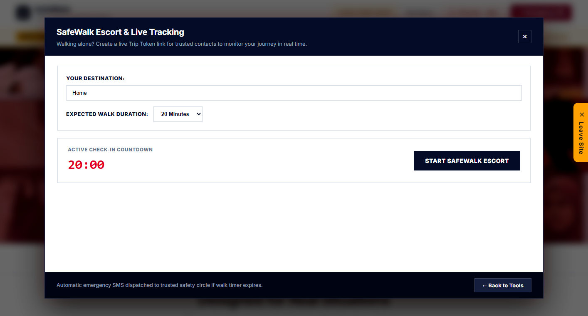

- **Dead Man's Timer:** Users set a transit window (5 to 60 minutes). If the timer expires without check-in, automated escalation triggers.
- **Route Breadcrumb Logging:** Tracks location checkpoints along the transit route.
- **Instant Escalation:** Allows the traveler to immediately notify their safety circle if they feel followed or unsafe.

---

### 6. Tell-Once: Trauma-Informed Incident Sanctuary
Survivors often have to recount agonizing details multiple times to police, lawyers, counselors, and family. **Tell-Once** guides survivors through a calm, multi-step intake once, and automatically formats specialized briefs for each agency.

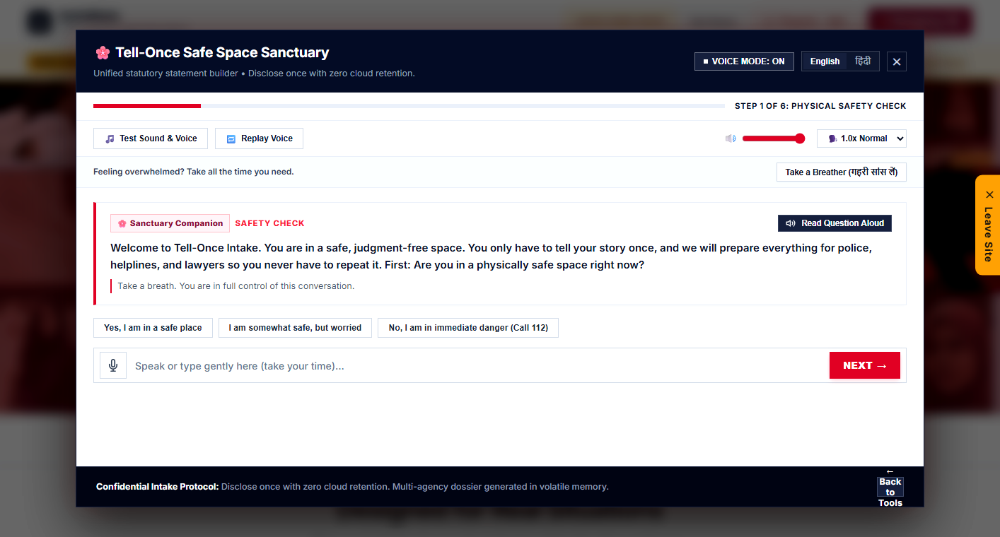

- **Bilingual Guided Voice / Text:** Step-by-step physical safety check, timeline capture, perpetrator details, and evidence cataloging in English and Hindi.
- **Statutory Multi-Agency Outputs:**
  1. **Police Complaint & Zero FIR:** Formatted in strict compliance with **BNSS Section 173** and **IT Act 66E / 67A**.
  2. **Legal Counsel Case Brief:** Chronological evidentiary timeline for attorneys and legal aid cells.
  3. **Medical & Counseling Intake:** Clinical context and emotional trauma assessment.
  4. **Support Circle Summary:** Plain-language safety summary for trusted friends and family.

---

### 7. Evidence Vault & Cryptographic Chain of Custody
Tamper-evident digital evidence repository that computes cryptographic SHA-256 hashes upon upload, preserving forensic chain-of-custody for legal admissibility under Indian and international evidence acts.

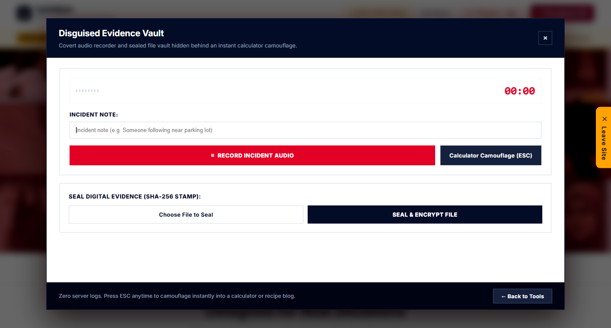

- **Cryptographic Fingerprinting:** SHA-256 HMAC hash generated immediately upon file staging.
- **Chain of Custody Metadata:** Records exact ISO timestamps, file size, MIME type, device metadata, and cryptographic digests.
- **Calculator Camouflage:** One-click camouflage transforms the vault into a functional calculator.

---

### 8. Leak-Tracer: Forensic Steganographic Watermarking
Enables users to protect sensitive photos before sharing them with intimate partners, agents, or colleagues by embedding invisible cryptographic recipient tags into image pixels.

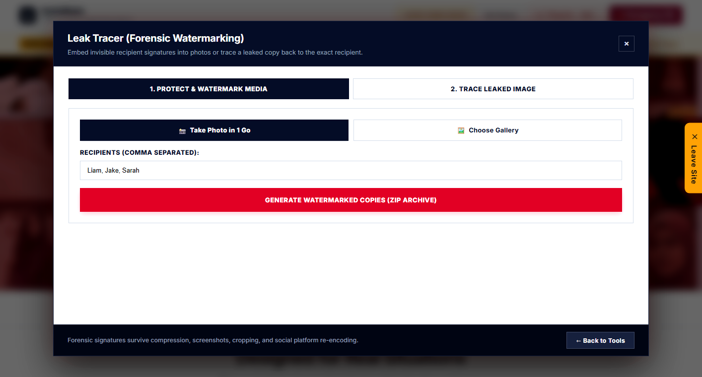

- **Invisible LSB Steganography:** Embeds encrypted recipient IDs (e.g., `"Liam"`, `"Jake"`, `"Sarah"`) into the least significant bits of image pixels with zero visual distortion.
- **Batch Export in 1 Go:** Automatically creates individually fingerprinted copies in a ZIP archive for each designated recipient.
- **Forensic Leak Identification:** If a photo is leaked online or shared maliciously, uploading the leaked copy extracts the hidden signature, unmasking the exact leaker.

---

### 9. Dual-Engine AI Deepfake & Media Screening
Forensic detection pipelines designed to screen manipulated media, non-consensual deepfakes, and synthetic images in memory.

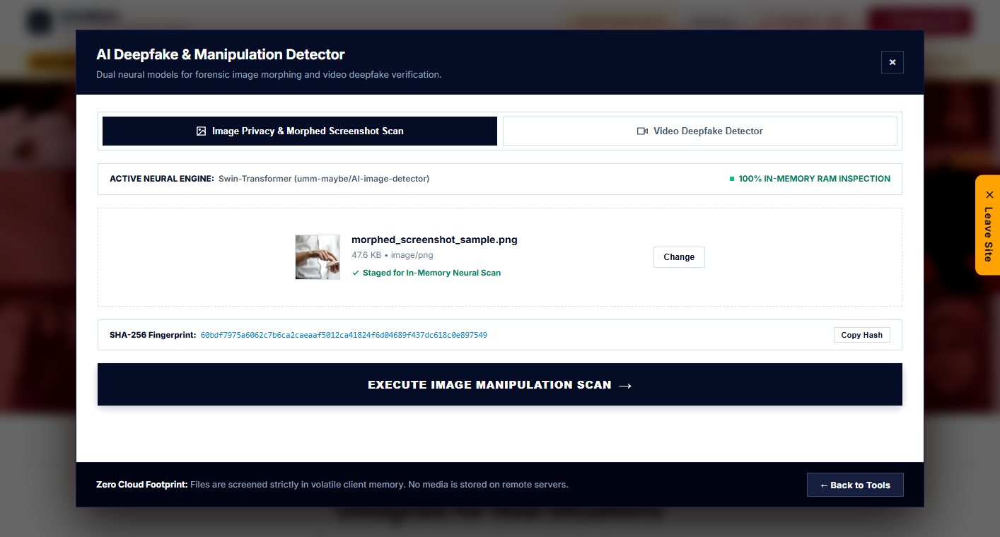

- **Still Image Diffusion Screening:** Powered by a pre-trained **Swin Transformer** (`umm-maybe/AI-image-detector`), screening for diffusion artifacts from Midjourney, DALL-E, and Stable Diffusion.
- **Video Face Manipulation Screening:** Powered by **MS-EffGCViT-B0** (Efficient Global Context Vision Transformer) and **YOLOv8n-Face** face detection, sampling video frames to detect face-swaps.
- **100% In-Memory Processing:** Uploaded images and video frames are decoded in volatile RAM (`io.BytesIO`) and purged immediately in a `finally` block.

---

### 10. Interactive Safety & Legal Assistant (Chatbot)
Statutory legal counselor and crisis assistant offering 9 structured triage workflows, emergency interrupt capabilities, and legal guidance under Indian law.

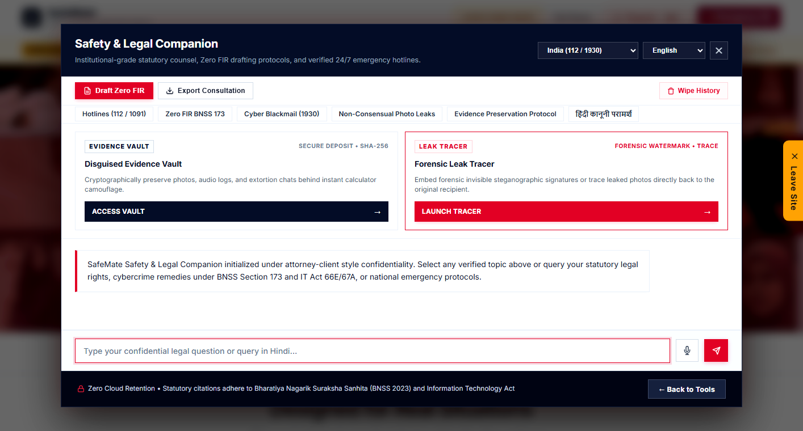

- **9 Guided Safety Flows:**
  1. `immediate_danger`: Emergency physical crisis triage & 112 hotline.
  2. `online_harassment`: Cyberstalking, trolling, abusive messages, or threats.
  3. `blackmail_threats`: Extortion, sextortion, or monetary coercion.
  4. `intimate_image_abuse`: Non-consensual media sharing & StopNCII.org intake.
  5. `impersonation_fake_profile`: Identity theft take-down workflows.
  6. `physical_harassment`: Street stalking & workplace POSH compliance.
  7. `report_cybercrime_india`: `cybercrime.gov.in` and 1930 helpline guidance.
  8. `preserve_evidence`: Digital forensics and chain-of-custody best practices.
  9. `understand_options`: Statutory rights under Zero FIR (BNSS 173) and IT Act.
- **Emergency Hotline Override:** Instant fallback to national helplines (**112**, **181**, **1091**, **1930**).

---

### 11. Stealth Panic Switch: Instant Recipe Disguise
A life-saving safety feature for individuals browsing in dangerous domestic environments. Hitting `ESC` or clicking the disguise button instantly masks the entire application with an authentic food blog.

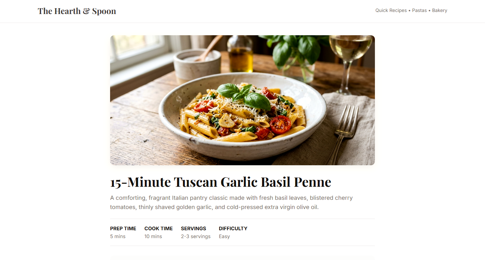

- **Instant Disguise:** Replaces active screen with **"The Hearth & Spoon: 15-Minute Tuscan Garlic Basil Penne"**.
- **Stealth Restore:** Clicking the recipe brand icon restores the survivor interface without losing in-progress work.
- **Quick-Leave:** Unconditionally redirects browser history to Google if an abuser enters the room.

---

### 12. Modular Feature Matrix & Urban Safety Hub
Interactive workspace linking physical transit safety, civic audit indexes, and digital forensics in one unified suite.

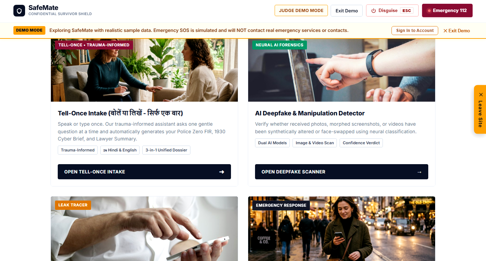

---

## System Architecture

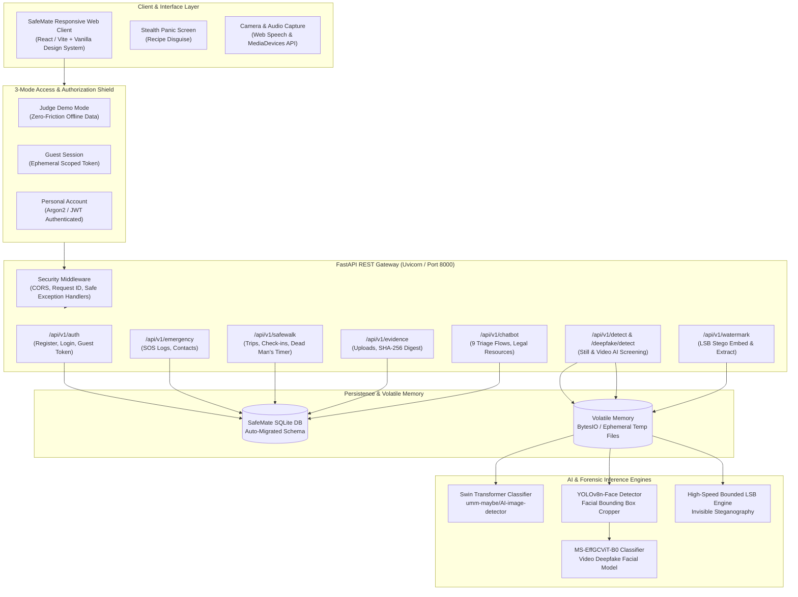

---

## Technology Stack

| Domain | Technology / Library | Version / Specs | Purpose |
| :--- | :--- | :--- | :--- |
| **Frontend Framework** | React + Vite | 18.x / Vite 8.3 | High-performance reactive UI components and dashboard |
| **Design System** | Vanilla CSS (Maitri Design Tokens) | Modern CSS Variables | Trauma-informed minimalist styling, zero bloat, high responsiveness |
| **Backend Framework** | FastAPI (Python) | Python 3.12+ | High-throughput async REST API engine |
| **Server Engine** | Uvicorn (ASGI) | 0.34+ | Production-grade async HTTP server |
| **Database & ORM** | SQLite + SQLAlchemy | SQLAlchemy 2.0+ | Relational persistence with runtime idempotent auto-migrations |
| **Authentication** | PyJWT + Passlib (Argon2 / Bcrypt) | JWT HS256 | 3-mode role authorization, stateless tokens, password hashing |
| **Still-Image AI Screening** | Hugging Face Transformers | Swin Transformer | In-memory diffusion artifact classifier (`umm-maybe/AI-image-detector`) |
| **Video Deepfake AI Screening** | PyTorch + Torchvision + OpenCV | MS-EffGCViT-B0 + YOLOv8n-Face | Facial frame extraction and temporal deepfake classification |
| **Forensic Watermarking** | NumPy + Pillow (PIL) | Custom Bounded LSB | High-speed invisible steganographic recipient fingerprinting |
| **Audio & Speech** | Web Speech API | Client Native | Bilingual (Hindi/English) speech-to-text intake and text-to-speech replay |
| **Testing & Verification** | Pytest + HTTPX + Selenium | Pytest 9.x | 214+ automated unit, integration, and end-to-end acceptance tests |

---

## Statutory & Legal Framework Reference

SafeMate is designed around verified legal mechanisms available to survivors under Indian and international statutes:

1. **Bharatiya Nagarik Suraksha Sanhita (BNSS) 2023 — Section 173 (Zero FIR):**
   - Mandates that any police station must register a First Information Report (FIR) regardless of territorial jurisdiction where the offense occurred.
   - SafeMate's **Tell-Once** incident brief formats complaints to meet statutory Zero FIR requirements.
2. **Information Technology Act, 2000:**
   - **Section 66E:** Violation of bodily privacy by capturing, publishing, or transmitting intimate images without consent.
   - **Section 67A / 67B:** Publishing or transmitting sexually explicit material or child sexual abuse material in electronic form.
3. **Emergency Helplines (India & Global):**
   - **112:** National Emergency Response Support System (ERSS).
   - **181 / 1091:** Women's Crisis Helpline (24/7 National).
   - **1930:** National Cybercrime Reporting Portal helpline (`cybercrime.gov.in`).
   - **StopNCII.org & Take It Down:** Global cryptographic hashing platforms to prevent intimate image re-upload.

---

## Local Development & Quick Start

### Prerequisites
- **Python:** Version 3.10+ (tested on Python 3.12.8)
- **Node.js:** Version 18+ (tested on Node v20/v22)
- **Git**

### 1. Clone the Repository
```bash
git clone https://github.com/sam9334545/Safemate.git
cd Safemate
```

### 2. Backend Setup
```bash
cd backend

# Create and activate virtual environment
python -m venv venv
# Windows:
.\venv\Scripts\activate
# Linux/macOS:
source venv/bin/activate

# Install dependencies
pip install -r requirements.txt

# Launch FastAPI backend
python -m uvicorn app.main:app --host 127.0.0.1 --port 8000
```
- Interactive Swagger API Documentation: `http://127.0.0.1:8000/docs`
- Health check: `http://127.0.0.1:8000/api/v1/health`

### 3. Frontend Setup
In a new terminal window:
```bash
cd frontend

# Install dependencies
npm install

# Build production bundle
npm run build

# Serve locally
python -m http.server 3000
# OR run Vite dev server
npm run dev
```
- Web Application: `http://localhost:3000/` (or `http://localhost:5173/`)
- Backend-mounted Static Frontend: `http://127.0.0.1:8000/app/`

---

## Automated Test Suite

SafeMate maintains rigorous test coverage spanning API endpoints, ownership isolation, path traversal guards, and judge demo scenarios:

```bash
cd backend
pytest tests/ -v
```

### Verified Test Matrix
- **`tests/test_judge_scenarios.py`**: 6 comprehensive acceptance scenarios verifying Judge Demo Mode, Ephemeral Guest Mode, Personal Accounts, Simulated SOS safety, and SafeWalk lifecycle.
- **`tests/test_authorization.py`**: Multi-tenant ownership isolation, unauthenticated 401 barriers, and cross-account access prevention.
- **`tests/test_watermark.py`**: Steganographic embed and extraction fidelity, recipient identification, and ZIP archive validation.
- **`tests/test_chatbot.py`**: Chatbot triage state machines, emergency override protocols, and Zero FIR dossier compilation.
- **`tests/test_detect.py` & `test_deepfake.py`**: Swin Transformer still-image screening and video face manipulation classifiers.

**Status:** `214 passed, 1 deselected in 100s (100% passing)`.

---

## Ethical Disclosures & Safety Commitments

1. **Non-Negotiable Demo Safety:** In Judge Demo Mode, Emergency SOS is strictly simulated. SafeMate will never transmit unauthorized calls, SMS, or network packets to emergency dispatchers (112) or real phone numbers without affirmative survivor action.
2. **Zero Cloud Retention:** Image and video screening occur strictly in volatile RAM (`BytesIO`). Files are unlinked and purged in `finally` blocks immediately upon analysis.
3. **Client-Side Privacy:** Ephemeral guest sessions store zero persistent identifiers on external servers.
4. **Stealth by Design:** Every screen supports instant panic camouflage (`ESC` key) to protect users from immediate domestic discovery.

---

## License & Attribution

SafeMate is released under the **MIT License**. Third-party models and components (`umm-maybe/AI-image-detector`, `MS-EffGCViT-B0`, `yolov8n-face`) remain subject to their respective upstream licenses as detailed in [`THIRD_PARTY_NOTICES.md`](THIRD_PARTY_NOTICES.md).
